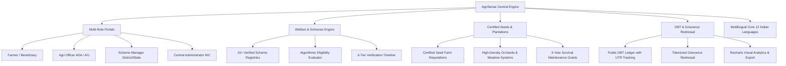

# AgriSense
### National Agriculture Schemes & Farmer Welfare Management System for India

> **AgriSense** is a comprehensive, production-ready digital agriculture welfare and farm management platform for India. Built to bridge the gap between farmers and government administration, it integrates central and state welfare schemes, certified seed distribution, high-density plantation programs, direct benefit transfer (DBT) tracking, grievance redressal, multi-role administration, and complete 12-language multilingual accessibility.

[](https://react.dev/)
[](https://www.typescriptlang.org/)
[](https://vitejs.dev/)
[](https://tailwindcss.com/)
[](#10-complete-12-language-multilingual-core)
[](#authoritative-data-sources)
[](LICENSE)

---

## Table of Contents

- [Executive Summary](#executive-summary)
- [System Architecture](#system-architecture)
- [Core Functional Modules](#core-functional-modules)
  - [1. Government Schemes & Eligibility Engine](#1-government-schemes--eligibility-engine)
  - [2. Certified Seed Distribution & Farm Hub](#2-certified-seed-distribution--farm-hub)
  - [3. Plantation & Agroforestry Programs](#3-plantation--agroforestry-programs)
  - [4. Dedicated Multi-Role Portals](#4-dedicated-multi-role-portals)
  - [5. Application Lifecycle & 6-Stage Verification](#5-application-lifecycle--6-stage-verification)
  - [6. Transparent DBT Beneficiary Public Ledger](#6-transparent-dbt-beneficiary-public-ledger)
  - [7. Citizen Grievance Redressal Portal](#7-citizen-grievance-redressal-portal)
  - [8. Welfare Analytics & Reporting](#8-welfare-analytics--reporting)
  - [9. Official Government Resources Directory](#9-official-government-resources-directory)
  - [10. Complete 12-Language Multilingual Core](#10-complete-12-language-multilingual-core)
  - [11. Agronomic Farm Management Suite](#11-agronomic-farm-management-suite)
- [Design System & Typography](#design-system--typography)
- [Tech Stack](#tech-stack)
- [Project Directory Structure](#project-directory-structure)
- [Getting Started](#getting-started)
- [Available Scripts](#available-scripts)
- [Authoritative Data Sources](#authoritative-data-sources)
- [License & Disclaimer](#license--disclaimer)

---

## Executive Summary

Indian agriculture sustains over 140 million farming households, yet small and marginal farmers frequently encounter fragmented information, complex subsidy procedures, and language barriers. 

**AgriSense** addresses these structural challenges by delivering an end-to-end, transparent, and farmer-centric platform that:
- Centralizes **15+ central and state government schemes** with real-time eligibility scoring based on landholding and category.
- Provides certified seed quotas from **Central and State Government Seed Farms** with granular agronomic parameters.
- Promotes orchard development and timber agroforestry through **3-year survival maintenance grant tracking**.
- Empowers all stakeholders through **instant role switching** across Farmers, Agricultural Officers, Scheme Managers, and Central Administrators.
- Ensures total transparency via a **public Direct Benefit Transfer (DBT) ledger** with PFMS UTR audit numbers.
- Operates across **12 major Indian languages**, changing the entire UI dynamically upon language selection.

---

## System Architecture



---

## Core Functional Modules

### 1. Government Schemes & Eligibility Engine
- **Extensive Scheme Coverage:** 15+ central and state schemes including:
  - **Income & Pension:** PM-KISAN (₹6,000/yr direct income support), PM-KMY (Pradhan Mantri Kisan Maandhan Yojana pension).
  - **Risk & Credit:** PMFBY (Pradhan Mantri Fasal Bima Yojana crop insurance), Kisan Credit Card (KCC 4% concessional credit), Agriculture Infrastructure Fund (AIF 3% interest subvention).
  - **Irrigation & Mechanization:** PMKSY-PDMC (Per Drop More Crop micro-irrigation), SMAM (Sub-Mission on Agricultural Mechanization up to 50–80% subsidy), PM-KUSUM (Component-B standalone solar agricultural pumps).
  - **Sustainable & Organic:** Paramparagat Krishi Vikas Yojana (PKVY ₹50,000/ha organic cluster assistance), Soil Health Card (SHC cycle-wise soil testing).
  - **Horticulture, Livestock & Fisheries:** MIDH (National Horticulture Mission), National Livestock Mission (NLM), PMMSY (Pradhan Mantri Matsya Sampada Yojana), NDRF/SDRF disaster relief.
  - **State-Specific Flagships:** Tamil Nadu KAVIADP & Comprehensive Micro-Irrigation (100% SF/MF subsidy), Andhra Pradesh YSR Rythu Bharosa, Maharashtra Krishi Swavalamban, Punjab Pani Bachao Paisa Kamao, Karnataka Krishi Bhagya.
- **Personalized Eligibility Engine:** Evaluates farmer land area (acres, hectares, bigha), category (SF/MF, SC/ST, Women), state applicability, and irrigation infrastructure to generate match scores (0–100%), passed requirements, and warning flags.
- **Structured Metadata:** Objectives, subsidy formulas, caps, required documents, deadlines, implementing directorates, official application URLs, and helpline numbers.

### 2. Certified Seed Distribution & Farm Hub
- **Seed Catalog & Classes:** Granular agronomic profiles across **Breeder, Foundation, Certified, and Hybrid** seed classes.
- **Technical Agronomy Specifications:** Sowing depth (cm), seed rates (kg/ha), spacing (row × plant), germination periods, seed treatments, critical irrigation stages, and pest resistance.
- **Government Seed Farm Network:** Sakkottai (Thanjavur), Coimbatore, Guntur, Rahuri, Ludhiana, and National Seeds Corporation (NSC) central hubs.
- **Subsidized Seed Requisitions:** Direct application workflow for subsidized seed allotments with Aadhaar-linked verification.

### 3. Plantation & Agroforestry Programs
- **High-Density & Meadow Orchard Development:** Technical spacing, pit preparation, and drip layouts for Mango, Guava, Apple, Acid Lime, Pomegranate, and Banana.
- **Timber & Commercial Species:** Teak, Malabar Neem (*Melia dubia*), Casuarina, Sandalwood, Bamboo, and Red Sanders.
- **3-Year Survival Maintenance Grants:** Structured grant disbursements under National Agroforestry Mission tied to survival thresholds:
  - *Year 1:* 100% initial establishment grant.
  - *Year 2:* 75% survival inspection clearance.
  - *Year 3:* 50% survival inspection clearance.
- **Certified Nurseries Directory:** Empaneled horticulture and social forestry nurseries with direct sapling booking.

### 4. Dedicated Multi-Role Portals
Seamless, instant role switching via the top bar or dashboard banner:
- **Farmer (Beneficiary):** Landholding overview, Aadhaar/DBT active indicators, personalized scheme recommendations, active application tracker, and input hub shortcuts.
- **Agricultural Officer (ADA/AO):** Block-level verification queue, document checks, geo-tagged field inspection logging, and block seed farm stock monitor.
- **Scheme Manager (State/District Cell):** District budget allocations vs. PFMS expenditures, sanction approval velocity (SLA: 7 days), and scheme-wise budget progress bars.
- **Central Administrator (NIC AgriStack Core):** National scheme master directory, external gateway status monitors (PM-KISAN, PFMS, Bhulekh/Patta, e-NAM, IMD Mausam), and audit log exports.

### 5. Application Lifecycle & 6-Stage Verification
- **4-Step Wizard:** Scheme selection, land and revenue record entry (Patta/Khatauni), document upload simulation, and bank DBT verification.
- **6-Tier Audit Timeline:**
  1. `Application Submitted` — Auto-generated tracking token.
  2. `Block Document Verification` — Assistant Agricultural Officer (AAO) land title review.
  3. `Field Inspection & Geotagging` — Assistant Agricultural Engineer (AED) ground check.
  4. `District Committee Sanction` — Joint Director of Agriculture (JDA) clearance.
  5. `Sanction Order Generation` — Downloadable and printable official sanction certificate.
  6. `Direct Benefit Transfer (DBT)` — Real-time PFMS credit notification with UTR transaction reference.

### 6. Transparent DBT Beneficiary Public Ledger
- Fully searchable public ledger indexing beneficiary names, masked accounts, bank IFSCs, installment sequence, disbursement amounts, and verified PFMS UTR references.
- One-click **CSV Data Export** for administrative auditing and RTI compliance.

### 7. Citizen Grievance Redressal Portal
- Dedicated filing for DBT credit delays, PMFBY insurance claim survey bottlenecks, seed shortages, and fertilizer overpricing.
- Unique tracking tokens (`GRV-2026-XXXX`) with SLA countdowns, assigned block officers, resolution remarks, and national agricultural helplines (1551, 1800-180-1551, 14447).

### 8. Welfare Analytics & Reporting
Interactive visualizations powered by **Recharts**:
- **District Disbursement Bar Chart:** Fund outlays and beneficiary numbers across districts.
- **Beneficiary Social Category Breakdown:** Pie charts representing SF/MF, SC/ST, Women, and General category distribution.
- **Application Velocity Line Chart:** Monthly application submissions vs. district clearance and DBT releases.
- **Budget Utilization Matrix:** Progress indicators showing approved budget vs. expenditure.
- **Export Capabilities:** Download CSV datasets or generate print-friendly reports.

### 9. Official Government Resources Directory
Curated repository linking directly to authoritative portals:
- Ministry of Agriculture & Farmers Welfare (MoA&FW)
- PM-KISAN, PMFBY, KCC, SMAM, and e-NAM
- ICAR (Indian Council of Agricultural Research)
- TNAU Agritech Portal & State Department Portals
- Searchable guidelines, downloadable circulars, and verified helpline contacts.

### 10. Complete 12-Language Multilingual Core
Full localization covering 100% of the UI across 12 Indian languages:
| Language | Native Label | Code |
| :--- | :--- | :--- |
| English | English | `en` |
| Hindi | हिन्दी | `hi` |
| Tamil | தமிழ் | `ta` |
| Telugu | తెలుగు | `te` |
| Kannada | ಕನ್ನಡ | `kn` |
| Malayalam | മലയാളം | `ml` |
| Marathi | मराठी | `mr` |
| Bengali | বাংলা | `bn` |
| Gujarati | ગુજરાતી | `gu` |
| Punjabi | ਪੰਜਾਬੀ | `pa` |
| Odia | ଓଡ଼ିଆ | `or` |
| Assamese | অসমীয়া | `as` |

*Changing the language selector in the top bar translates every navigation link, card, form, table header, and status badge instantly.*

### 11. Agronomic Farm Management Suite
- **Crop Catalogue:** In-depth growing guides, Kharif/Rabi/Zaid seasonality, water requirements, and suitable soil types.
- **e-NAM Mandi Prices:** Live modal prices, daily ranges, and Minimum Support Price (MSP) benchmarks.
- **Agro-Meteorological Advisory:** Multi-day forecasts, rainfall probabilities, and spray/irrigation feasibility warnings.
- **Soil Health Card & NPK Advisory:** Soil test interpretation, nutrient ratings, and organic amendments.
- **Pests & Diseases Diagnostic:** Cultural, biological, and chemical IPM measures.
- **Farm Financial Ledger:** Cost of cultivation tracking across seeds, fertilizers, irrigation, labor, and crop produce sales.
- **AI Agricultural Assistant:** Context-aware interactive agronomy advisory.

---

## Design System & Typography

AgriSense implements a clean, professional, modern government-service design system:
- **Strict Color Palette:** 
  - **Surfaces:** Pure white (`#ffffff`), subtle neutral surfaces (`#fbfdfb`), and crisp light green (`#f0fdf4`). Zero dark blue or slate colors.
  - **Primary & Accent:** Agricultural greens (`#16a34a`, `#15803d`, `#166534`).
  - **Typography:** Pure crisp black (`#000000`) for headers and primary text; neutral charcoal (`#171717`) and neutral gray (`#525252`) for secondary and muted text.
  - **Borders:** Clean neutral gray (`#e5e7eb`).
- **Typography:**
  - **Primary Font:** `Geist Thin` with balanced Geist font weights (`100` to `700`) for headers, statistics, and body text.
  - **Secondary Font:** `Inter` for tabular and numerical data.
- **Accessibility:**
  - High-contrast mode toggle (`html.high-contrast`).
  - Font scaling toggle (`html.large-text`).
  - Reduced motion support (`html.reduced-motion`).
  - Semantic HTML5 with ARIA labels on all interactive elements.

---

## Tech Stack

| Category | Technology |
| :--- | :--- |
| **Frontend Framework** | [React 19](https://react.dev/) + [TypeScript 5.7](https://www.typescriptlang.org/) |
| **Build & Bundler** | [Vite 6.0](https://vitejs.dev/) with fast HMR |
| **Styling & Design** | [Tailwind CSS v4](https://tailwindcss.com/) + CSS Custom Tokens |
| **Typography** | Google Fonts: [Geist](https://fonts.google.com/specimen/Geist) & [Inter](https://fonts.google.com/specimen/Inter) |
| **Routing** | [React Router v7](https://reactrouter.com/) (Code-split lazy routes) |
| **Icons** | [Lucide React](https://lucide.dev/) |
| **Data Visualization** | [Recharts](https://recharts.org/) |
| **State & Persistence** | React Context API + LocalStorage with Schema Migrations |
| **Form Handling** | Controlled component architecture with type-safe state validation |

---

## Project Directory Structure

```text
agrisense/
├── public/                       # Static web assets, manifest, PWA worker
│   ├── favicon.svg
│   ├── manifest.json
│   └── sw.js
├── src/
│   ├── app/                      # Application root, router, and context providers
│   │   ├── App.tsx
│   │   ├── main.tsx
│   │   ├── providers.tsx         # Global context (Language, Role, State, District, Profile)
│   │   └── router.tsx            # Lazy code-split routes
│   ├── components/               # Design system & shared components
│   │   ├── feedback/             # ConfirmDialog, Toast
│   │   ├── forms/                # FormField, Input, Select, SearchInput
│   │   ├── layout/               # AppShell, Sidebar, TopBar, GlobalSearch
│   │   └── ui/                   # Button, Card, StatCard, Badge, WeatherIcon, Skeleton
│   ├── data/                     # Authoritative data records & registries
│   │   ├── applications.ts       # Sample applications & verification workflows
│   │   ├── crops.ts              # Crops catalog & growth stages
│   │   ├── dbtRecords.ts         # Transparent DBT beneficiary ledger
│   │   ├── governmentResources.ts# Official portal URLs, circulars, helplines
│   │   ├── grievances.ts         # Grievance tickets & SLAs
│   │   ├── locations.ts          # Indian states, districts, and coordinates
│   │   ├── marketPrices.ts       # e-NAM mandi prices & MSP benchmarks
│   │   ├── pestsDiseases.ts      # Pest & disease diagnosis library
│   │   ├── plantations.ts        # Orchard development, timber, 3-yr maintenance grants
│   │   ├── schemes.ts            # 15+ central & state welfare schemes
│   │   ├── seeds.ts              # Certified seed varieties & government seed farms
│   │   ├── weather.ts            # Agro-meteorological forecasts & alerts
│   │   └── translations/         # 12 Indian language dictionaries
│   │       ├── en.ts, hi.ts, ta.ts, te.ts, kn.ts, ml.ts
│   │       ├── mr.ts, bn.ts, gu.ts, pa.ts, or.ts, as.ts
│   │       └── index.ts          # Central localization dictionary map
│   ├── features/                 # Modular feature views
│   │   ├── analytics/            # Recharts Welfare Analytics & Report Generator
│   │   ├── applications/         # Application Wizard, Timeline, Printable Receipt
│   │   ├── assistant/            # AI Agricultural Chatbot
│   │   ├── calendar/             # Farm Operations & Season Calendar
│   │   ├── crops/                # Crop Catalogue & Variety Guides
│   │   ├── dashboard/            # Multi-Role Dashboard (Farmer, Officer, Manager, Admin)
│   │   ├── dbt/                  # Transparent DBT Beneficiary Public Ledger
│   │   ├── finances/             # Revenue & Cost Ledger
│   │   ├── grievances/           # Grievance Redressal Portal & Ticket Tracking
│   │   ├── knowledge/            # Agronomy Articles & Practice Guides
│   │   ├── market/               # Mandi Market Tickers & Price Trends
│   │   ├── notifications/        # Deadline Reminders & Alerts
│   │   ├── pests-diseases/       # IPM Diagnostic Tool
│   │   ├── plantations/          # High-Density Orchards, Timber & Nurseries
│   │   ├── profile/              # Farmer Profile, Landholdings & Bank Records
│   │   ├── recommendations/      # Algorithmic Crop Suitability Engine
│   │   ├── resources/            # Official Government Resource Directory
│   │   ├── schemes/              # Government Schemes Explorer & Eligibility Scoring
│   │   ├── seeds/                # Certified Seed Distribution & Seed Farm Hub
│   │   ├── soil/                 # Soil Health Card & NPK Calculator
│   │   └── weather/              # Weather Forecasts & Advisory
│   ├── lib/                      # Business logic & helper utilities
│   │   ├── eligibilityEngine.ts  # Algorithmic scheme eligibility evaluator
│   │   ├── formatters.ts         # Currency, date, and unit formatters
│   │   ├── storage.ts            # LocalStorage key management
│   │   └── weatherApi.ts         # Live Open-Meteo API connector
│   ├── styles/                   # Core CSS and Tailwind definitions
│   │   └── index.css             # Light green and pure black design system tokens
│   └── types/                    # Shared TypeScript interfaces
│       └── index.ts              # Schemes, Seeds, Plantations, Applications, Roles, Profile
├── index.html                    # HTML entry with Geist & Inter Google Fonts
├── package.json
├── tsconfig.json
└── vite.config.ts
```

---

## Getting Started

### Prerequisites

- [Node.js](https://nodejs.org/) (version 18.x or higher)
- `npm` (version 9.x or higher)

### Installation

1. **Clone the repository:**
   ```bash
   git clone https://github.com/thillairaghu2005/AgriSense.git
   cd AgriSense
   ```

2. **Install dependencies:**
   ```bash
   npm install
   ```

3. **Start the local development server:**
   ```bash
   npm run dev
   ```
   Open your browser and navigate to `http://localhost:5173`.

---

## Available Scripts

| Command | Purpose |
| :--- | :--- |
| `npm run dev` | Starts the local Vite development server with Hot Module Replacement (HMR). |
| `npm run build` | Runs TypeScript compilation (`tsc -b`) and generates production bundles with Vite. |
| `npm run preview` | Previews the production build locally before deployment. |
| `npm run test` | Executes unit tests via Vitest. |
| `npm run lint` | Runs fast Oxlint code quality checks across the repository. |

---

## Authoritative Data Sources

AgriSense adheres strictly to authoritative public datasets published by the Government of India and State Agricultural Departments:

| Source | Organization | Portal / Reference |
| :--- | :--- | :--- |
| **PM-KISAN** | Ministry of Agriculture & Farmers Welfare, GoI | [pmkisan.gov.in](https://pmkisan.gov.in) |
| **PMFBY** | Ministry of Agriculture & Farmers Welfare, GoI | [pmfby.gov.in](https://pmfby.gov.in) |
| **PMKSY (PDMC)** | Department of Agriculture and Farmers Welfare | [pmksy.gov.in](https://pmksy.gov.in) |
| **SMAM** | Mechanization & Technology Division, MoA&FW | [agrimachinery.nic.in](https://agrimachinery.nic.in) |
| **MIDH** | Mission for Integrated Development of Horticulture | [midh.gov.in](https://midh.gov.in) |
| **Soil Health Card** | Department of Agriculture and Farmers Welfare | [soilhealth.dac.gov.in](https://soilhealth.dac.gov.in) |
| **e-NAM** | Small Farmers' Agri-Business Consortium (SFAC) | [enam.gov.in](https://enam.gov.in) |
| **ICAR** | Indian Council of Agricultural Research | [icar.org.in](https://icar.org.in) |
| **TNAU Agritech** | Tamil Nadu Agricultural University | [agritech.tnau.ac.in](https://agritech.tnau.ac.in) |
| **Uzhavan App** | Department of Agriculture, Government of Tamil Nadu | [tnagrisnet.tn.gov.in](https://tnagrisnet.tn.gov.in) |

---

## License & Disclaimer

- **License:** Distributed under the open-source [MIT License](LICENSE).
- **Disclaimer:** All scheme criteria, subsidy calculations, and contact directories are synthesized from published official central and state government guidelines. Farmer profile data, sample applications, and grievance tickets are illustrative for demonstration and verification purposes. Always verify final application submissions on official government portals (`.gov.in` / `.nic.in`).
